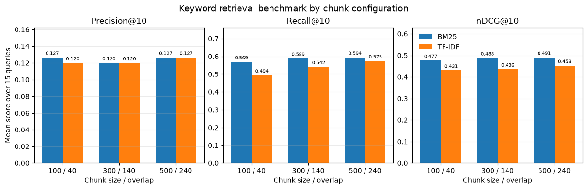
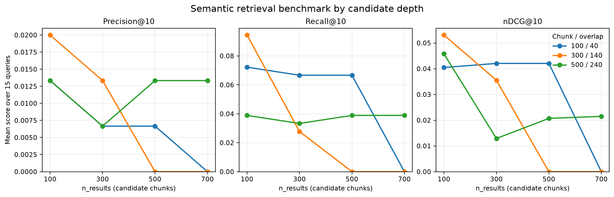
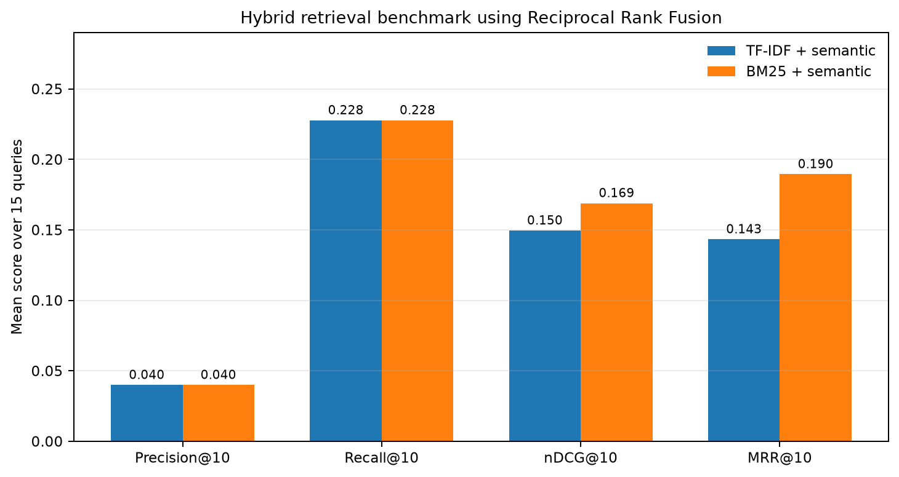

# Agentic RAG for French Case Law

## Project overview

This project helps users find French court decisions by topic, select relevant cases,
and ask follow-up questions grounded in passages from those cases. A React and TypeScript
frontend communicates with a FastAPI backend. LangGraph connects the monitoring, research,
reranking, question-answering, and general-chat nodes.

The application does not expose private model reasoning. It reports user-facing progress,
retrieval methods, fallback status, selected cases, answers, and citations.

## Architecture

```text
User
  |
  v
React and TypeScript frontend
  | HTTP POST and Server-Sent Events
  v
FastAPI routes and in-memory session controller
  |
  v
LangGraph
  |
  +--> Monitoring node and LLM intent router
  |      |
  |      +--> General chat node --> Short conversational response
  |      |
  |      +--> QA node --> Chroma search restricted to selected source IDs
  |                         |
  |                         +--> Grounded answer with verified chunk citations
  |      |
  |      +--> Research node
  |      |      |
  |      |      +--> Hybrid, BM25, semantic, or TF-IDF retrieval
  |      |             |
  |      |             +--> Ordered fallback methods if no cases are found
  |                    |
  |                    +--> Retrieval node --> LLM reranking to at most 5 distinct cases
  |
  v
Chroma collection mounted from Backend/Collections
  |
  +--> Separate LLM service configured through Backend/.env
```

The monitoring node classifies each message as an explicit case search, a question about
already selected cases, or general conversation. Search requests run Research and then
Retrieval. Questions run QA only when the session has selected cases. Greetings and other
general messages use the chat node and do not run retrieval.

The graph stores state in the API session for this prototype. Session data is held in process
memory; it is lost on restart and is not shared across multiple workers.

## Comparison with the classic RAG project

The earlier project is available at
[AitMoussa-Ali/RAG_jurice_prudence](https://github.com/AitMoussa-Ali/RAG_jurice_prudence).
Its keyword search reads and ranks chunks directly. Its semantic search calls Chroma for a
fixed number of chunks. The retrieval code in that repository does not consistently group
ranked chunks into distinct cases by source ID before returning results. Its hybrid search
file is empty at the referenced repository revision, despite hybrid retrieval being described
in the project documentation.

This project separates the workflow into LangGraph nodes with a shared state:

- Monitoring chooses between search, follow-up QA, and general chat.
- Research runs the selected retrieval strategy and its no-results fallback.
- Retrieval groups and reranks the candidate cases by source ID.
- QA searches only chunks belonging to the selected source IDs and verifies citations.
- The FastAPI controller preserves selected cases in a session and streams progress to the UI.

The architecture changed because the product has two different tasks: finding candidate
cases and answering questions about selected cases. Separating them makes their inputs,
outputs, failure paths, and progress visible to the UI. A classical single retrieval-and-answer
chain does not provide the same explicit routing or case-selection boundary.

This is a prototype, not a fully persistent production service. Sessions currently live in
process memory.

## Retrieval benchmark and current parameters

The retrieval notebooks compare results at the case level: ranked chunks are grouped by
`source_id`, and precision, recall, and nDCG are measured against reference source IDs.
The evaluation set contains 15 queries. The relevance labels are provisional and were not
independently validated, so the scores below are indicative rather than a reliable estimate
of real-world performance.

Keyword evaluation across the tested chunk configurations:

```text
Method  Chunk size / overlap  Precision@10  Recall@10  nDCG@10
BM25    100 / 40              0.1267        0.5694     0.4766
BM25    300 / 140             0.1200        0.5889     0.4884
BM25    500 / 240             0.1267        0.5944     0.4908
TF-IDF  100 / 40              0.1200        0.4944     0.4306
TF-IDF  300 / 140             0.1200        0.5417     0.4361
TF-IDF  500 / 240             0.1267        0.5750     0.4527
```



The semantic evaluation varied `n_results` across 100, 300, 500, and 700 chunks. For the
300 / 140 collection, `n_results=100` scored Precision@10 0.0200, Recall@10 0.0944, and
nDCG@10 0.0531; at 300, the corresponding values were 0.0133, 0.0278, and 0.0355. Increasing
the number of candidates did not consistently improve the measured results.



The hybrid notebook evaluated 15 queries with `top_k=10`, `n_results=100`, and RRF `k=60`:

```text
Method                     Precision@10  Recall@10  nDCG@10  MRR@10
TF-IDF + semantic with RRF 0.0400        0.2278     0.1496   0.1433
BM25 + semantic with RRF   0.0400        0.2278     0.1690   0.1895
```



The current application uses the `jurisprudence_chunk_300_overlap_140` collection,
`top_k=10` for initial retrieval, `n_results=100`, and RRF `k=60`. Retrieval then reranks
the candidates to at most 5 selected cases. These are operational choices, not proven global
optima: the lexical notebook scored the 500 / 240 configuration slightly higher, while the
smaller `n_results` setting limits candidate work. The benchmark labels need manual review
before drawing firm conclusions.

There is also a result to revisit: the current Hybrid implementation combines TF-IDF and
semantic retrieval, while the recorded hybrid benchmark has higher nDCG@10 and MRR@10 for
BM25 plus semantic retrieval. Validate the reference labels and rerun the comparison before
changing the production default.

## Fallback and error handling

The default search method is Hybrid. The user can instead choose TF-IDF, BM25, or Semantic.
If the selected strategy returns no cases, Research tries the remaining strategies in this
order:

```text
BM25, Semantic, TF-IDF
```

The requested strategy is skipped if it already ran. Fallback is triggered only when no
distinct case is returned. It does not mean that the system judged existing results to be
irrelevant. The search result records the requested method, methods attempted, and method
that returned cases.

The Retrieval node checks that reranked source IDs belong to the candidate list and are not
duplicated. QA restricts Chroma search to the selected source IDs and rejects citations to
chunks that were not supplied to the model. If there are no selected cases or no matching
passages, the system returns an explicit no-evidence response.

If a user asks about a case before selecting any, the router does not call QA. It responds
conversationally and the user can first request a case search. Invalid structured LLM output
or an execution error is reported to the client as an SSE error event; it is not silently
converted into a successful search result. The user can clarify the request and retry.

## Prompts and agent responsibilities

The prompts are defined in the agent modules under `Backend/Agents`:

- Monitoring router: returns one structured intent, `search_cases`, `ask_question`, or `chat`.
  It is instructed not to treat a greeting or general conversation as a case search.
- Chat node: responds briefly to general messages, describes the application's case-law
  capabilities, and does not invent legal references or start retrieval.
- Retrieval node: ranks only the supplied candidate cases, returns at most five distinct
  source IDs, and provides a short relevance reason for each.
- QA node: answers in French using only retrieved passages, ignores instructions embedded
  in those passages, and returns the exact source ID and chunk ID of every cited passage.

The prompts request structured outputs where routing, reranking, or citations need validation.
Private chain-of-thought is neither requested as a user-visible output nor sent over the API.
The API streams operational stages and results instead.

## Docker deployment

The root `Dockerfile` builds the frontend and backend into one image. FastAPI serves the
compiled frontend and the API on port 8000. The Chroma database is deliberately not copied
into the image: the local collection directory is approximately 867 MB and is mounted into
the container. The selected collection must exist at `Backend/Collections` before starting;
the database files are not included in this Git repository and must be provided separately.
The local `jurisprudence_chunk_300_overlap_140` collection currently contains 38,976 chunks.

The Docker dependency file contains the CPU runtime packages used by the API. It does not
install the CUDA-enabled PyTorch stack listed for the development and notebook environment.

The LLM is a separate service. Create a local configuration file from the example:

```powershell
Copy-Item Backend\.env.example Backend\.env
```

Edit `Backend/.env` and set `LLM_MODEL`, `LLM_BASE_URL`, and `LLM_API_KEY`. For an Ollama
service running on the Docker host, the example uses `http://host.docker.internal:11434/v1`.
For another provider, use its compatible API URL and credentials. Do not commit the `.env`
file.

```powershell
docker compose build
docker image ls jurisprudence-agentic-rag
docker compose up -d
```

Open the application at `http://localhost:8000`. The FastAPI documentation is at
`http://localhost:8000/docs`; the health endpoint is `http://localhost:8000/health`.
The build downloads the Python and Node packages and preloads the tokenizer and Chroma
embedding model, so it requires network access. The LLM service must be reachable at runtime.

Useful commands:

```powershell
docker compose logs -f app
docker compose ps
docker compose down
```

The collection is mounted read-write so Chroma can maintain its local database files. Do not
run multiple replicas against the same local Chroma directory. Sessions remain in memory and
are lost when the container is recreated. On Linux, grant UID 10001 write permission to
`Backend/Collections` before starting the container if the bind mount is not writable by
the container user.

## API

- `POST /api/sessions` creates a session and returns its `session_id`.
- `POST /api/sessions/{session_id}/messages` accepts a message and optional retrieval method.
  The response is a Server-Sent Events stream with `progress`, `completed`, and `error`
  events. The frontend consumes this POST stream with Fetch.
- `GET /api/sessions/{session_id}` returns current session data and selected cases.
- `DELETE /api/sessions/{session_id}` deletes an idle session.
- `GET /health` checks that the backend is running.

Example request body:

```json
{
  "message": "Je cherche des affaires concernant la resiliation d'un contrat de travail",
  "selected_method": "Hybrid"
}
```

Supported methods are `Hybrid`, `BM25`, `Semantic`, and `TF-IDF`. If `selected_method` is
omitted, Hybrid is used.

## Code map and references

Backend:

- [Backend overview and local API instructions](Backend/README.md)
- [FastAPI application entry point](Backend/main.py)
- [LangGraph monitoring and router](Backend/Agents/Monitoring_agent.py)
- [Research agent and retrieval fallback](Backend/Agents/Research_agent.py)
- [Case reranking node](Backend/Agents/Retreival_agent.py)
- [Question answering node](Backend/Agents/QA_agent.py)
- [API controllers](Backend/Controllers/)
- [API routes](Backend/Routes/)
- [Keyword retrieval implementation](Backend/Retreival/KeywordSearch.py)
- [Hybrid retrieval implementation](Backend/Retreival/HybridSearch.py)
- [Keyword benchmark notebook](Backend/Evaluation/Keyword_evaluation.ipynb)
- [Semantic benchmark notebook](Backend/Evaluation/Semantic_evaluation.ipynb)
- [Hybrid retrieval notebook](Backend/Retreival/HybridSearch.ipynb)
- [Generated benchmark plots](Backend/Evaluation/plots/)

Frontend:

- [Frontend application](Frontend/frontend/)
- [Chat interface and progress display](Frontend/frontend/src/Layout/Layoutpage.tsx)
- [Frontend API client and SSE parser](Frontend/frontend/src/services/api.ts)
- [Chat and agent state types](Frontend/frontend/src/types/chat.ts)
- [Frontend package scripts](Frontend/frontend/package.json)
